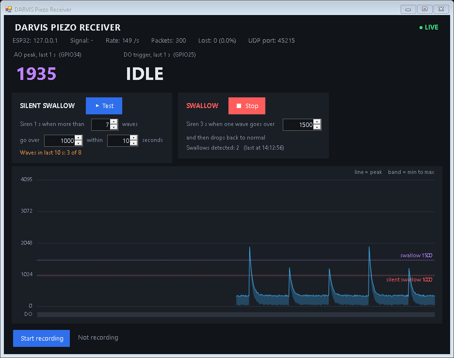

# DARVIS Piezo Monitor

A swallow and vibration monitor built from an ESP32 and a piezo sensor. The ESP32 reads the sensor 1,000 times a second and streams the results over Wi-Fi to a Windows app, which shows a live graph, records data to CSV and sounds a siren when it detects a swallow pattern.

Everything stays on your local network. No cloud account or subscription is needed.



> [!WARNING]
> **This is not a medical device.** It is an experimental hobby and research project. It hasn't been clinically tested and it can miss events or raise false alarms. Don't rely on it for diagnosis, treatment or patient safety.

## Contents

- [What you need](#what-you-need)
- [1. Wire it up](#1-wire-it-up)
- [2. Upload the ESP32 code](#2-upload-the-esp32-code)
- [3. Connect the ESP32 to Wi-Fi](#3-connect-the-esp32-to-wi-fi)
- [4. Build and start the receiver](#4-build-and-start-the-receiver)
- [5. Check the sensor works](#5-check-the-sensor-works)
- [Using the alarms](#using-the-alarms)
- [Recording data](#recording-data)
- [Troubleshooting](#troubleshooting)
- [How it works](#how-it-works)

## What you need

**Hardware**
- ESP32 development board (built for "ESP32 Dev Module")
- Piezo vibration sensor module with **AO** (analog) and **DO** (digital) outputs, plus its piezo disc
- Jumper wires
- USB cable that carries **data**, not just power

**Software**
- A Windows 10 or 11 PC to run the receiver
- [Arduino IDE 2](https://www.arduino.cc/en/software)

**Network**
- A **2.4 GHz** Wi-Fi network, because the ESP32 can't join 5 GHz
- The PC and the ESP32 must be on the same network

## 1. Wire it up

| Sensor module | ESP32 |
|---|---|
| VCC | 3V3 |
| GND | GND |
| AO | GPIO34 |
| DO | GPIO25 |

> [!CAUTION]
> Always connect the piezo disc **through the sensor module**, never directly to an ESP32 pin. A hard tap can make a bare disc produce a voltage spike big enough to damage the ESP32.

**Looking after the disc:** the red wire goes on the white centre and the black wire on the brass edge. The solder joints are fragile, so tape the wires to the disc or cover the joints with hot glue, so that pulling on the cable doesn't pull on the joints. Don't bend the disc, because the ceramic layer cracks easily.

## 2. Upload the ESP32 code

1. Download this project: click the green **Code** button at the top of this page, choose **Download ZIP**, and extract it.
2. Open Arduino IDE and go to **File → Preferences**. Under **Additional boards manager URLs**, add:
   ```
   https://espressif.github.io/arduino-esp32/package_esp32_index.json
   ```
3. Open **Tools → Board → Boards Manager**, search for **esp32**, and install **esp32 by Espressif Systems**.
4. Open **Tools → Manage Libraries**, search for **WiFiManager**, and install **WiFiManager by tzapu**.
5. Open `esp32_piezo_sensor/esp32_piezo_sensor.ino`.
6. Select **Tools → Board → esp32 → ESP32 Dev Module**, then pick your board's port under **Tools → Port**.
7. Click **Upload**.

If no port appears, or the upload fails, see [Troubleshooting](#troubleshooting). Many boards need the BOOT button held during upload.

*Last built with esp32 board package 3.3.12 and WiFiManager 2.0.17.*

## 3. Connect the ESP32 to Wi-Fi

You only need to do this once, because the ESP32 remembers your network.

1. Power the ESP32. It starts its own Wi-Fi network called **DARVIS-PIEZO**.
2. Connect your phone to **DARVIS-PIEZO**. A setup page should open. If it doesn't, go to `192.168.4.1` in the browser.
3. Choose your Wi-Fi network, enter the password and save.

Do this within 3 minutes, or the ESP32 restarts and you'll need to reconnect to DARVIS-PIEZO.

To check it worked, open **Tools → Serial Monitor** at **115200** baud. You should see `WiFi Connected. IP: ...`, then `System Ready`, then lines starting with `AO peak = ...`.

## 4. Build and start the receiver

1. Open the `receiver` folder and double-click **`build.bat`**. It uses the C# compiler that comes with Windows, so there's nothing to install. When it finishes, press any key to close the window.
2. Double-click the new **`PiezoReceiver.exe`**.
3. If Windows Firewall asks, click **Allow**, and tick both **Private** and **Public** networks. Without this, the readings are blocked.

The top-right corner should show **● LIVE** and **Rate** should be about 20 /s.

## 5. Check the sensor works

| Test | What you should see |
|---|---|
| Leave the disc still for 10 seconds | A flat, steady line. Note this resting level. |
| Tap the disc | A sharp spike, then back to the resting level |
| Tap softly, then harder | Harder taps give taller spikes |
| Move the wires gently without touching the disc | The line stays mostly flat. Big spikes mean a loose solder joint. |
| Turn the small screw on the module | DO stays **IDLE** at rest and shows **TRIGGERED** only on firm taps |

Then tape or strap the disc to the skin at your throat, stay still for 10 seconds, swallow a few times and watch the height of each wave. Use those heights to set the alarm levels below.

## Using the alarms

The receiver has two alarms. Each has its own card with number boxes and a **▶ Test** button that plays its siren. Changes apply immediately and are remembered the next time you open the app.

| Alarm | When it sounds | Siren | Starting values |
|---|---|---|---|
| **Silent swallow** | More than **7** waves go over **750** within **10** seconds | 1 second | All three can be changed |
| **Swallow** | One wave goes over **1500** and then drops back to normal | 3 seconds | The level can be changed |

**How waves are counted**
- A wave starts when the signal rises over the lower of the two levels.
- It ends when the signal is back to normal, meaning under 90% of that level. A signal hovering around the line counts as one wave, not many.
- A finished wave that went over the swallow level counts as a **swallow**. One that only went over the silent swallow level counts toward **silent swallow**. The same wave never counts for both.
- After a silent swallow siren, the wave count restarts from 0.
- Changing any alarm setting also restarts the count.

If both alarms fire close together, a swallow interrupts a silent swallow siren, but not the other way round.

The right levels vary from person to person and depend on where the disc sits, so expect to adjust them. The graph shows both levels as dashed lines.

## Recording data

Click **Start recording** and choose where to save. The app writes one row per 50 ms window to a CSV file you can open in Excel:

| Column | Meaning |
|---|---|
| `pc_time` | Time on the PC |
| `esp_uptime_ms` | Milliseconds since the ESP32 started |
| `seq` | Message number, used to spot lost messages |
| `ao_peak` / `ao_min` / `ao_avg` | Highest, lowest and average reading in the window (0–4095) |
| `do_triggered` | 1 if DO fired during the window |
| `samples` | Readings in the window, normally about 50 |
| `rssi` | Wi-Fi signal strength in dBm |

## Troubleshooting

**Uploading**

| Problem | Fix |
|---|---|
| No port in Arduino IDE | Try another USB cable, because many are power-only. Then install the USB driver for your board's chip: [CP210x](https://www.silabs.com/developer-tools/usb-to-uart-bridge-vcp-drivers) or CH340. Check Device Manager under **Ports (COM & LPT)**. |
| Stuck at `Connecting....`, or `Wrong boot mode detected (0x13)` | Click Upload. When `Connecting...` appears, press and **hold BOOT** until `Writing at 0x...` appears. |
| Holding BOOT doesn't help | Unplug the board, connect **IO0 to GND** with a jumper wire, plug it in and upload. Then remove the wire and press **EN**. |
| You want uploads to work without pressing BOOT | Solder a **10 µF capacitor** between **EN** and **GND**. |
| `Port is busy` or `could not open port` | Close the Serial Monitor and any other program using the port. |

**Receiver**

| Problem | Fix |
|---|---|
| Stays on **WAITING FOR ESP32** | Check the PC and ESP32 are on the same network and that the app is allowed through Windows Firewall, including on Public networks. |
| Still waiting, and the Serial Monitor shows the ESP32 is connected | Guest, school and hotel Wi-Fi often block devices from talking to each other. Use a home router or a phone hotspot. |
| `Could not listen on UDP port 4210` | The receiver is already open. Close the other copy. |
| `build.bat` says the file is in use | Close `PiezoReceiver.exe` and run it again. |
| **Lost** percentage is high | The Wi-Fi signal is weak or busy. Move the ESP32 closer to the router. |

**Sensor**

| What you see | Likely cause |
|---|---|
| Flat line near 0, no reaction to taps | The disc is disconnected, AO is on the wrong pin, or the module has no power |
| Line stuck at 4095 | AO is wired to VCC by mistake, or there's a short circuit |
| Jumpy line when nothing touches it | Loose ground wire or bad solder joint |
| DO shows TRIGGERED all the time | Turn the screw on the module, or set `DO_ACTIVE_LEVEL` to `LOW` in the sketch and upload again |

## How it works

```
Piezo disc -> sensor module -> ESP32 ---- Wi-Fi (UDP port 4210) ----> Windows receiver
                               1,000 readings/s                       graph, alarms, CSV
                               20 summaries/s
```

The ESP32 reads the sensor every 1 ms. Every 50 ms it broadcasts a summary of that window, so short spikes aren't lost:

```json
{"seq":42,"ao":3100,"lo":180,"avg":900,"do":1,"n":50,"rssi":-58,"up":123456}
```

| Field | Meaning |
|---|---|
| `seq` | Message number |
| `ao`, `lo`, `avg` | Highest, lowest and average reading in the window |
| `do` | 1 if DO fired during the window |
| `n` | Readings in the window |
| `rssi` | Wi-Fi signal strength |
| `up` | Milliseconds since the ESP32 started |

**Privacy:** readings are broadcast **without encryption or a password**, so anyone on the same network can see them, and any device there could send fake readings. Only use it on a network you trust.

**Things you can change**

| What | Where |
|---|---|
| Sampling and send rate | `SAMPLE_INTERVAL_US` and `SEND_INTERVAL` in the sketch |
| DO polarity | `DO_ACTIVE_LEVEL` in the sketch |
| Network port | `RECEIVER_PORT` in the sketch **and** `Config.Port` in `receiver/PiezoReceiver.cs` |
| Siren lengths and "back to normal" level | `SilentSirenSeconds`, `SwallowSirenSeconds` and `WaveRearm` in `receiver/PiezoReceiver.cs`, then run `build.bat` again |
| Blynk app support (off by default) | Set `USE_BLYNK` to `1` in the sketch, add your own Blynk values and install the Blynk library |

Alarm settings are saved in `receiver/PiezoReceiver.settings.txt`. Delete that file to go back to the starting values.

## License

Released under the [MIT License](LICENSE). It comes with no warranty of any kind.
